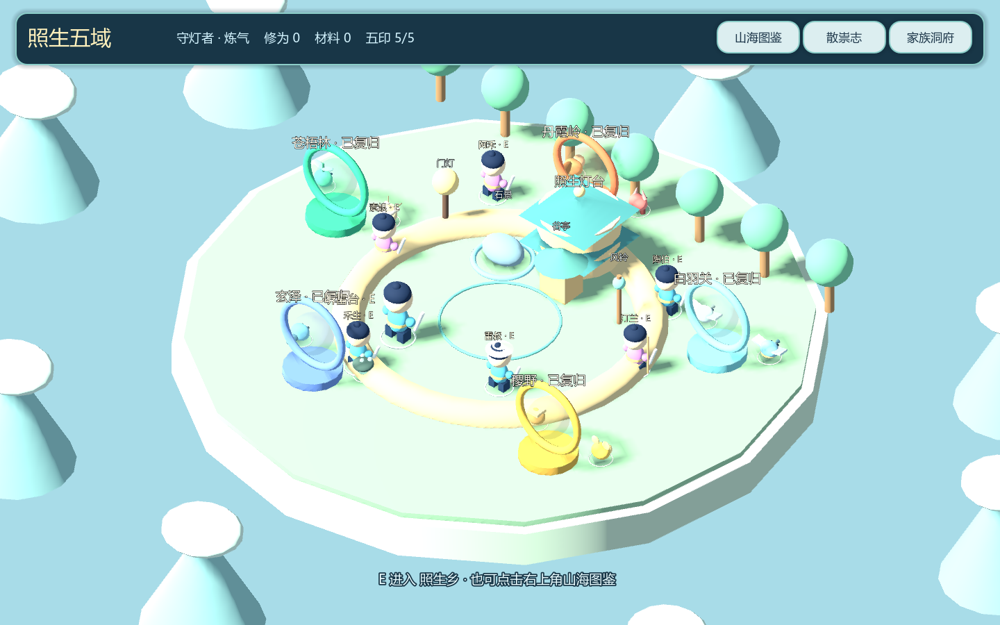

# 家族修真录 · 照生五域

全新 **Q版立体卡通＋斜俯视2.5D** Godot4可玩原型：20只Boss、10种散祟、6位可交谈乡民。新入口使用真正的Node3D场景、正交镜头、立体人物和原创异兽；首批 Blender 精修资产已接入，旧像素仙村保留为历史场景。

## 启动

使用 Godot **4.7.2** 打开 `project.godot` 后按 F5。Windows可双击 `启动试玩.cmd`，或将环境变量 `GODOT4` 指向自己的Godot可执行文件。启动脚本不再依赖原作者的F盘安装路径。

- 默认入口：`scenes/campaign_main.tscn`
- 旧版入口：`scenes/main.tscn`，在编辑器中单独运行可回看。
- 运行时20Boss资料：`data/campaign_bosses.json`
- 本机默认存档：D盘存在时使用 `D:/Projects/Codex/user-data/xiuxian/five_realms_v3.json`；启动脚本指定为项目 `output/`。可用 `XIUXIAN_SAVE_DIR` 自定。
- 其他平台回退 `user://five_realms_v3.json`。新旧存档分开，旧记录不被覆盖。损坏存档保留原文件，暂停自动覆盖。

## 操作与游玩顺序

| 操作 | 按键 |
|---|---|
| 相对镜头移动 | WASD / 方向键 |
| 故乡加速 | Shift |
| 近身攻击 | J / 鼠标左键 / 屏幕按钮 |
| 所选功法 | 1 |
| 定时护盾 | K |
| 闪避 | 空格 |
| 传送门 / 阵眼 | E |
| 暂停 / 返回 | Esc |

1. 选择Q版形象与名字，进入听雷教学。至少成功躲过或挡下一次预警，才完成试灯。
2. 通过3D故乡传送门或右上角山海图鉴，任选五域。全部20只Boss都有背景故事、目标、真实攻击与结算。
3. 五域篇章先收拢两种散祟：它们的低伤害招式会教你当地机制，并补充局内资源；随后看Boss地面预警，移开、护盾或闪避；靠近阵眼按E削弱护障，再抓反击窗口。一般节点也能近身攻击破除。
4. 首通获得修为与固定材料；在家族洞府安放门灯、石景、谷亭、风铃，物件会出现在3D故乡。
5. 五主祟分别给予五行印，集齐后开启执衡终章。支线和两条生活旁篇可自由体验。
6. 图鉴中可选故事/标准难度、雷诀/镇心/分流构筑。所有战斗都能免费重试，没有每日出战硬锁。
7. 家园里的“命影状态演示”仅切换明确标注的模拟预设，下一场生效；不读取真实医疗数据。

## 已实现范围

- 原创Q版3D人物、五行传送门、浮岛故乡与配色不同的战场。
- Blender MCP 已实测连通；窃荣精修模型、7骨骼三段动画、曲面照生灯台和 Sapling 林木已导出并进入游戏，交付 .blend 源文件和 GLB。
- 20个数据驱动Boss入口与背景故事，程序化差异造型、多种空间招式和阵眼反制。
- 预警与命中共享空间参数，攻击距离、冷却、真气、体力、护盾、闪避、暂停、受击保护。
- 教学掌握门槛、五域解锁、首通幂等奖励、五印终章、可视家园、损坏存档保护。
- 17个临床主题与3个纯虚构Boss。医学资料与幻想招式分开；五行是美学分类。
- 10种小怪的独立故事、真实攻击、局内资源恢复、散祟图鉴和战后归巢；6位3D乡民有委托与战后对白。
- 相同难度、功法和模拟状态下的个人最佳时间记录，为重复练习提供掌握目标。
- 本地世界Boss“晦鳞”。没有把本地贡献冒充多人共享服务器。

这是可玩的功能原型，已跑通 Blender 制作管线并完成首批三件资产。其余19只Boss和小怪、NPC仍以程序化模型为主。完整20Boss商业级精修、完整动作库、开放世界、真实健康接口、临床判定、多人服务器及网页导出包尚未完成。

## 文档和全部Boss资料

- [游戏总设计V2](outputs/game-design-v2/游戏总设计_V2.md)
- [20只Boss形象与背景故事](outputs/game-design-v2/二十祟兽名录与故事_V2.md)
- [首章剧本](outputs/game-design-v2/序章与玄泽第一章剧本_V2.md)
- [Blender MCP、免费插件研究与实际资产交付](docs/BLENDER_PIPELINE.md)
- [攻击与Godot实现对照](docs/BOSS_IMPLEMENTATION.md)
- [10种小怪与6位NPC的故事、建模及闭环](docs/MINIONS_AND_NPCS.md)
- [当前可玩版本的循环与奖励](docs/GAMEPLAY_V3.md)
- [原始五祟概念图与提示词](outputs/boss-design-v1/)
- [结构化设计名录](outputs/game-design-v2/boss_catalogue_v2.json)

V2设计文档保留创作过程中的完整目标；它早先写的“未接入”描述属于当时状态。**当前实现范围以本文与BOSS_IMPLEMENTATION为准。** 后续美术按用户确认的Q版3D方向继续制作，不把早期绢本概念图当现成游戏模型。

## 验证

PowerShell：

```powershell
./scripts/run_tests.ps1 -GodotPath '你的Godot4控制台可执行文件'
```

脚本先导入资源，再运行234项战役测试、61项原版本回归和48项Blender资产集成检查。测试使用项目work目录独立存档，日志不提交。测试结果与运行截图见后续验证记录。

## 工程入口

| 文件 | 职责 |
|---|---|
| scripts/campaign/world.gd | 三维场景、角色操作、地面预警、命中反馈 |
| scripts/campaign/encounter.gd | 确定性战斗、技能、反制、胜负 |
| scripts/campaign/state.gd | 存档、进度、奖励、家园、模拟快照 |
| scripts/campaign/ui.gd | 开始、图鉴、故事、设置、暂停、结算 |
| scripts/campaign/creatures.gd | 原创程序化Q版人物与异兽 |
| scripts/campaign/catalogue.gd | Boss资料读取与索引 |
| tests/campaign_test.gd | 20Boss、判定、进度、存档、真实场景测试 |

引擎写法参考Godot官方 [Control](https://docs.godotengine.org/en/stable/classes/class_control.html)、[2D/3D绘制](https://docs.godotengine.org/en/stable/tutorials/2d/custom_drawing_in_2d.html) 与 [Web导出](https://docs.godotengine.org/en/stable/tutorials/export/exporting_for_web.html)。

## 可编辑模型场景

assets/generated/bosses 内有20个Boss场景，minions内有10个小怪场景，npcs内有6位乡民。可在Godot编辑器单独打开调整节点和材质；运行时优先加载这些场景。tools/build_models.gd 可重新生成原型（会覆盖对应生成场景，精修前请另存）。

小怪与人物详见 [散祟与乡人志](docs/MINIONS_AND_NPCS.md)。


## 实机与检查结果

新战役234项、旧版61项引擎断言全部通过；36个可编辑模型已导出。[验证记录与实际运行截图](docs/VALIDATION.md)。


