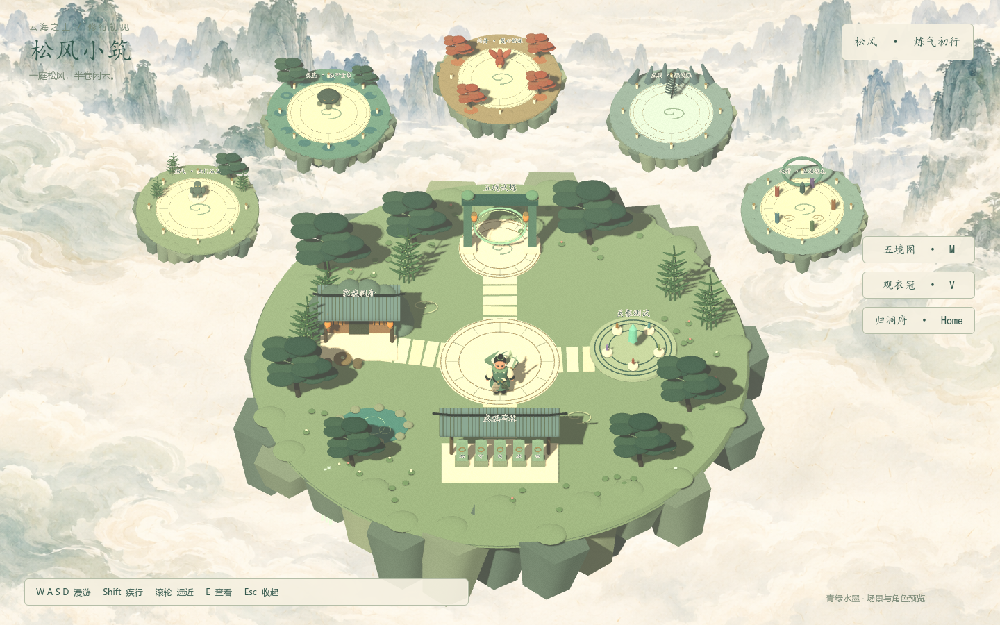

# 家族修真录 · 松风仙境

当前默认启动为青绿水墨风的 Godot 4.7 场景漫游版。主角「松风」、主岛和五个试炼环境均为真实 3D 网格，采用固定俯视的 2.5D 表现；云海远山是绘制的背景，角色和建筑不是背景贴图。

## 启动

双击 `启动试玩.cmd`，或在 Godot 4.7.2 中打开 `project.godot`，等待首次资源导入完成后按 F5。

本机引擎路径为 `F:\Godot_v4.7.2-stable_win64.exe`。其他电脑可以直接使用 Godot 编辑器启动。



## 操作

| 操作 | 按键 |
| --- | --- |
| 按画面方向移动 | WASD / 方向键 |
| 疾行 | 按住 Shift |
| 拉近 / 拉远镜头 | 鼠标滚轮 |
| 人物近景 / 恢复全景 | V，或右侧「观衣冠」 |
| 打开五境图，选择场景 | M，或右侧「五境图」 |
| 查看附近地点 / 打开试炼入口 / 离开试炼 | E |
| 返回主岛 | Home，或右侧「归洞府」 |
| 收起地图或地点介绍 | Esc |
| 保存运行截图 | F12，保存到 `output/ink/screenshot.png` |

## 已完成

- 松风角色：青白衣袍、银白鬓角、发髻、饕餮玉扣、悬浮短剑、朱红剑穗、动态披帛。
- 独立四肢走路动画、平滑转身、移动加减速、疾行、待机呼吸及浮剑动画。
- 主岛：中央云纹庭院、家族洞府、茶桌、灵根测试台、成就碑林、五境入口、竹林、松树、池塘及瀑布。
- 五个可独立进入、可移动的试炼环境：竹石山门、碧潭玄龟、丹枫狐境、逐雷高台、五相天阙。主岛远处的小浮岛是这些场景的缩略景观。
- 岛边、洞府建筑、碑林及部分雕像的物理碰撞。
- 五境选择界面、地点介绍、近景观察、建筑屋顶近距离隐藏以减少遮挡。

当前范围是人物与环境搭建、WASD 漫游。首领为静态场景造型，尚未接入战斗、属性成长、普攻、四个技能、健康资料解析或联网。原有玩家存档没有迁移、重置或改写。

## 场景与脚本

| 文件 | 用途 |
| --- | --- |
| `scenes/main.tscn` | 默认主岛，可在编辑器中选择、编辑原生网格和碰撞体 |
| `scenes/ink/songfeng.tscn` | 可复用主角模型及碰撞体 |
| `scenes/ink/trial_1.tscn` … `trial_5.tscn` | 五个独立试炼场景 |
| `scripts/ink/hero.gd` | 移动、转身、走路及浮剑动画 |
| `scripts/ink/world.gd` | 镜头、地点、场景切换、截图 |
| `scripts/ink/hud.gd` | 界面、五境图与地点介绍 |
| `scripts/ink/mesh_library.gd` | 原生网格、云纹、曲面屋顶、植被等构件 |
| `scripts/ink/hero_model.gd` | 主角模型构建源文件 |
| `scripts/ink/scenery.gd` | 主岛与五境的建模源文件 |
| `tools/build_ink_world.gd` | 根据建模源文件重新生成全部场景 |
| `assets/ink/` | 材质、原始概念图、水墨背景与美术说明 |

场景已经生成，不需要先运行构建脚本。可以直接编辑 `.tscn` 中的原生节点；如果修改构建源文件后重新生成，会覆盖这些场景中的手动修改。

重新生成场景：

```powershell
Start-Process -FilePath 'F:\Godot_v4.7.2-stable_win64.exe' -ArgumentList @('--headless', '--path', 'F:\godot\xiuxian', '--script', 'res://tools/build_ink_world.gd') -Wait -WindowStyle Hidden
```

检查移动、碰撞及场景切换：

```powershell
Start-Process -FilePath 'F:\Godot_v4.7.2-stable_win64.exe' -ArgumentList @('--headless', '--path', 'F:\godot\xiuxian', '--script', 'res://tests/ink_world_test.gd', '--log-file', 'F:\godot\xiuxian\output\ink\tests.log') -Wait -WindowStyle Hidden
```

## 旧版本

旧像素入口保留在 `scenes/pixel-legacy.tscn`，说明保留在 `README-pixel-legacy.md`；旧低多边形入口为 `scenes/lowpoly.tscn`。旧资源、业务脚本、玩家存档与 Godot AI 插件未删除。旧玩法回归测试 `tests/gameplay_test.gd` 已指向像素入口；默认冒烟测试现在运行水墨版的移动与场景检查。

## Boss 素材

已从 [PR #1](https://github.com/Oii6111/xiuxian/pull/1) 的 `1232dcac04609bccbfe35782e8b2b9241371fa4c` 提交取回 20 个 Boss、10 类小怪、6 位 NPC 的原生 Godot 模型及相关原画、配置和设计文档。它们保留在原目录，不改变水墨主场景的默认入口，也尚未替换当前五个试炼场中的静态造型。

- 模型：`assets/generated/bosses/`、`assets/generated/minions/`、`assets/generated/npcs/`。
- 原画与设定：`outputs/boss-design-v1/`、`outputs/game-design-v2/`。
- 配置与再生成方式：[远端素材导入记录](docs/REMOTE_BOSS_ASSETS.md)。

## Git 上传与下载

Git 同步提交记录及提交中包含的文件。保存文件不会自动上传；`commit` 只保存在本机，`push` 后 GitHub 才能看到。

首次下载仓库：

```bash
git clone https://github.com/Oii6111/xiuxian.git
```

已有本地仓库，先查看自己的改动，再获取远端记录：

```bash
git status
git fetch origin
git log --oneline HEAD..origin/main
```

本地工作已保存到提交或暂存备份、且没有分叉时，使用 `git pull --ff-only` 更新当前分支。多人分别修改了同一个文件时，需要先处理合并，不能用整份旧目录覆盖新目录。

上传自己完成的工作：

```bash
git add <需要上传的文件或目录>
git diff --cached --stat
git commit -m "Describe the change"
git push origin main
```

多人协作可先创建 `codex/功能名` 等独立分支，推送后发起 PR。PR 内的文件在合并前不一定出现在 `main` 中；本次 Boss 素材来自这种情况。

模型、贴图、脚本、场景、`.uid` 与 `.import` 配置需要一起同步。`.godot/` 缓存、个人存档、日志与本地备份按 `.gitignore` 排除。
