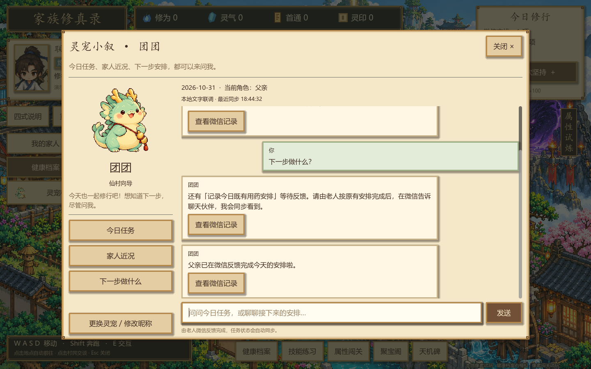

# 给整合同学：游戏、灵宠与微信接入参考

更新日期：2026-10-31。

## 当前成果与边界

原 PR 的抽卡装备、账号家族、四款灵宠与聊天框继续保留。本次增加不依赖模型密钥的本地文字联调：确认已有安排 → 游戏出现任务 → 老人确认完成 → 灵宠自动显示完成。采用真实老人端 Python 消息模块、显式适配扩展、合成身份及独立用户目录。

这不是微信账号已登录、小游戏已发布或 C 正式账本已接入。浏览器只替代微信文字传输；任务投影为会话内联调夹具；正式资源和存档不因演示变动。

## 建议阅读顺序

1. [本地文字联调与运行方法](WECHAT_LOCAL_LINK.md)：一键入口、实际链路、读取协议与验证。
2. [完整业务对接说明](WECHAT_COMPANION_HANDOFF.md)：仅按确认事实开启任务、本人微信反馈完成、绑定、同步、去重及验收。该文档中的新增正式接口属于方案，不代表 C 已实现。
3. [已有聊天接口](COMPANION_API.md)：聊天文字/导航与任务同步是两条接缝。
4. [本地玩法与 C 账本对齐研究](LOCAL_GAME_C_LEDGER_ALIGNMENT.md)：以当前本地玩法和数值为准，补接口和归属；不要采用 C 的联调示例改写五档装备、70/700抽卡价格和每日100灵气。
5. 上游 [微信任务桥接方案](https://github.com/Oii6111/xiuxian/blob/bf5ad8580729351bfb91fac68eecec5dd2acb13d/docs/TASK_REMINDER_BRIDGE.md)、[后端合并指南](BACKEND_INTEGRATION.md)。

## 实际代码入口

| 位置 | 职责 |
|---|---|
| `scripts/companion_task_client.gd` | 只读共享任务，按账号/会话/版本隔离；不写角色余额或装备 |
| `scripts/companion_context.gd`、`companion_panel.gd` | 用共享任务回答今日安排、下一步；显示同步时间 |
| `tools/wechat_link_demo/sidecar_adapter.py` | 明确当前安排才发计划事件；缺信息继续追问；过滤未共享记录；持久队列与失败重试 |
| `tools/wechat_link_demo/host.py` | 仅回环地址运行的测试传输和内存任务投影，不是正式 C 服务 |
| `tools/wechat_link_demo/sidecar/` | 上游固定提交的5个原样模块，来源见目录内 UPSTREAM.md |
| `tools/启动微信灵宠联调.cmd` | 启动独立文字网页与游戏预览 |

## 本轮研究结论

- 原 `wechat-bridge` 主要是“已有任务 → 提醒 → 回传结果”，没有完成“微信聊到明确内容 → 创建适用任务”。提醒门槛需要前移到任务启用阶段。
- 新 `wechat-sidecar` 提供文字入口、候选确认和健康事件出口，但健康事件不是 C 的 task-results 协议；需由可信适配层补任务实例/绑定/版本和鉴权，不能直接换 URL。
- 已确认用药安排只写本地疗程时，游戏不会自动知道。本地扩展增加最小计划事件；不把药名、读数、图片和私人聊天放进游戏投影。
- 原桥接器按关键词和唯一待办回退会误接否定语句；照片也不能自动证明完成。当前扩展针对否定/疑问和含糊的“药吃完了”补充门槛；真实语言/多用药仍由 D 验收。
- 原侧车缺天数时默认7天、推送失败仍标记同步，不符合本产品要求。本地扩展改为补问和持久重试；这些修正需要 D 审阅后合入自己的真实服务。
- 多老人需要独立身份与消息路由；当前演示先使用一位虚构老人。普通游戏拒绝 local_demo 快照，避免演示数据混入真实账号。
- 游戏中不要求年轻人二次审批正常的微信本人自述；完成状态和奖励到账分开展示。

## 接下来由谁补齐

- D：将稳定 message_id、已确认计划及完成/结束事件接入真实微信服务，明确共享授权，并验证自然语言、语音和图片。
- C：提供真实绑定及角色映射、权威任务/账本、读取投影、限权凭证与恢复机制。当前 `/api/v2/snapshot`、`quests.list` 与本地读取结构需要适配，不能直接互换。
- B：保留当前灵宠与像素玩法，切换到 C 提供的正式读取投影。大模型密钥留在 D/后端，不进入 Godot 或存档。

## 验证与发布范围

本地版本247项检查通过：联调16、适配8、原灵宠46、抽卡59、家族53、账号17、默认登录3、主地图45。运行方式见 WECHAT_LOCAL_LINK.md；PR独立目录保留旧场景、GameKernel/GameApi接缝，不覆盖开发者本地工作区。

本次只发布代码、接口研究及虚构界面截图。未发布 `.env`、密钥、数据库、玩家存档、聊天记录、真实报告或运行缓存。上游老人模块原样来自本仓库提交 `bf5ad8580729351bfb91fac68eecec5dd2acb13d`。
