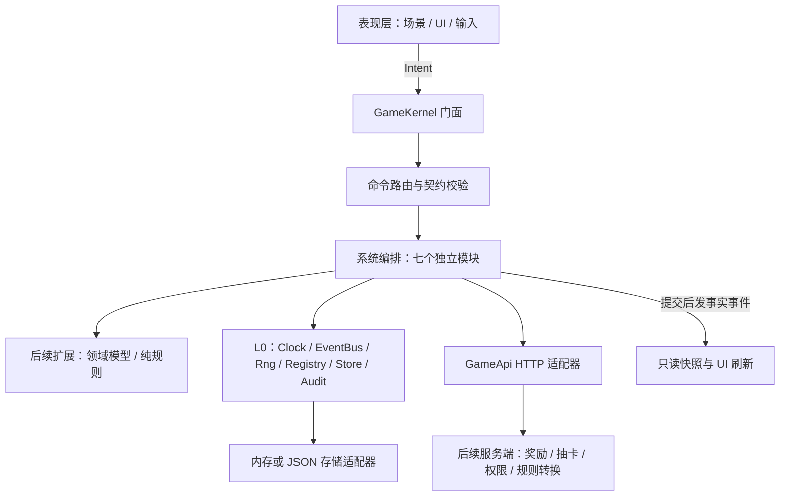

# v2 内核与团队接入指南

依据：[项目设计文档 v2](../家族修真录-设计文档-v2.md)，重点为第 3、14、19、20 节。

本次交付是可运行的客户端内核与系统扩展骨架。时间、事件、随机、配置、状态存储、版本迁移、命令路由和审计已经实现；七个业务系统只有明确的接口与职责，尚未实现玩法。所有占位命令返回 `NOT_IMPLEMENTED`。

现有像素仙村仍可运行。新系统通过 `GameKernel` 接入，旧 `game_state.gd` 和 `pixel_campaign/state.gd` 尚未迁移。不要把旧玩法里的本地发奖或渡劫战斗当成 v2 的规则。

## 1. 运行入口

实际项目根目录是 `.deploy/repo/`，请用 Godot 4.7.2 打开这里的 `project.godot`。

- F5：现有游戏；`GameKernel` 自动装配新内核。
- 打开 `scenes/kernel/workbench.tscn` 按 F6：查看七个系统状态，点击按钮验证命令调用。
- 命令行无存档演示：`godot --path . --scene res://scenes/kernel/workbench.tscn -- --kernel-ephemeral`。
- 验证：`powershell -ExecutionPolicy Bypass -File tools/test_kernel.ps1 -Godot '你的 Godot 控制台可执行文件路径'`。

测试使用内存会话及 `work/kernel/` 临时文件，不加载玩家的内核存档。测试脚本对引擎错误、脚本错误、断言失败和未完成的测试都会失败退出；仅 Windows 系统证书库不可读这一宿主错误单独报告为警告，离线测试不据此判定 HTTPS 可用。

## 2. 分层与依赖方向



依赖向下；系统之间通过已声明的事件和数据契约协作，不访问其他系统的内部状态。领域模型和纯规则未来放入各系统自己的子目录；这些代码不能访问节点、文件或网络。文件访问集中于装配层和 L0 存储适配器，网络访问集中于 `scripts/net/`。

UI 只能调用 `GameKernel.dispatch()`、`snapshot()`、`subscribe()` 等门面接口。`Runtime.services` 仅供装配、系统和测试使用，不暴露给 UI。GDScript 的下划线不是安全隔离；模块所有权属于代码约定，正式权限仍由后端验证。

## 3. 目录与职责

| 位置 | 职责 |
|---|---|
| `scripts/autoload/game_kernel.gd` | 单一 Autoload，装配入口、UI 门面、退出清理 |
| `scripts/kernel/runtime.gd` | 组合基础服务、系统注册、启动和关闭 |
| `scripts/kernel/system_module.gd` | 系统生命周期、状态、迁移、命令处理的统一基类 |
| `scripts/kernel/system_context.gd` | 显式注入的共享服务，不查找全局节点 |
| `scripts/kernel/command_router.gd` | 按命令名路由，严格输入校验，异步 Result 返回 |
| `scripts/kernel/event_bus.gd` | 已声明事实事件、独立载荷副本、订阅令牌 |
| `scripts/kernel/clock.gd` | Unix 秒、UTC+8 游戏日、周一日期作为周标识 |
| `scripts/kernel/random_streams.gd` | 按用途隔离的种子随机流 |
| `scripts/kernel/registry.gd` | 按 id 索引的只读配置副本 |
| `scripts/kernel/store.gd` | 模块状态区、校验、整份载入、模块版本迁移 |
| `scripts/kernel/adapters/` | 内存与本地 JSON 存储实现 |
| `scripts/kernel/audit.gd` | 有界内存记录，只保留命令名、错误码和时间 |
| `scripts/systems/<系统>/module.gd` | 团队成员各自开发的系统入口 |
| `scripts/net/game_api.gd` | 游戏域 HTTP 传输；需要显式配置并挂到场景树 |
| `data/kernel/contracts.json` | 命令、事件、枚举和资源归属的共同契约 |
| `scenes/kernel/` | 使用真实 Autoload 的开发接入工作台 |
| `tests/kernel_test.gd` | 基础服务、失败路径、模块装配和工作台接入测试 |

## 4. 系统划分

| 系统 | 进一步开发内容 | 主要命令 | 边界 |
|---|---|---|---|
| `growth` 养成 | 童子、多修仙者、属性、境界、装备、背包、抽卡 | create / select / equip / draw | 服务端计算资源和抽卡；灵根创建后固定 |
| `combat` 战斗 | 战斗会话、属性快照、单人关卡、组队结果 | start / finish | 即时操作；只上报战果，不决定健康结局 |
| `quests` 任务 | 模板、进度、列表、领奖请求 | list / claim | 验证倍率、去重与每日限额在服务端 |
| `lifecycle` 生命周期 | 修行、渡劫、闭关、飞升、阶段、庆典 | request_change / confirm_change / update_stage | 家属确认驱动；与战斗、世界章节分离 |
| `story` 剧情 | 对话、个人章节、全服天道进度 | advance | 读服务端解锁事实，不改变生命周期 |
| `social` 社交 | 名片、洞府、好友、护法、展示模式、道统碑 | visit / bless / set_visibility | 公开字段白名单，不接触原始健康数据 |
| `season` 赛季 | 赛季同步、体检提醒、刷新流程 | refresh | 永久积累保留；不得在计时器中重置装备 |

组队网络传输由后端联机负责人实现，战斗模块消费会话与队伍快照；系统间不互相持有 Node。`growth` 内部的抽卡/装备/境界等可继续拆文件，不需要为每一项再增加全局单例。

## 5. 公共契约

所有请求返回以下结构，失败时 `data` 为空对象：

```json
{"ok": true, "code": "OK", "message": "", "data": {}}
```

`contracts.json` 是当前客户端接口的唯一登记表。每个命令名有系统前缀，字段全部必填，拒绝未知字段。支持 `string`（非空）、`integer`、`number`、`bool`、`array`、`object`，只允许 JSON 值；不允许 Node、Resource、Vector2 或 Callable。向量应在业务契约中显式定义 x/y 数值。

通用路由只校验结构和基本类型。枚举、数值范围、角色归属、状态迁移、奖励资格、重复请求由具体系统和服务端校验；不能把字符串类型校验误当授权。枚举查询示例：`_context.registry.get_entry("enums", "elements").value`。资源归属查询使用 `resource_owners` 表。

灵石、境界经验、材料、装备和保底计数必须使用 `cultivator_id` 隔离；功德使用童子账号。新增资源时先更新契约，禁止临时引入“全家共享灵石”。`request_id` 是后续服务端幂等键，当前内核不会假装已经实现服务端去重。

事件是已经发生的事实，命令是请求执行的意图。例如提交状态后通知 `kernel.state_changed`，监听方重新读取快照。事件总线是同步进程内分发，无重放、无网络、无可靠投递；回调应短小，不能相互递归发布。跨网络事件在验证后转换为明确游戏事件，不把整份服务器对象随意广播。

## 6. 扩展一个系统

1. 在自己的 `module.gd` 覆盖 `initial_state()` 和 `validate_state()`，只保存游戏状态，使用明确字段白名单。
2. 在 `contracts.json` 增加或调整命令及事件；讨论共享接口后再改，避免各人发明不同字段。
3. 覆盖 `execute(command, payload)`。本地规则计算用独立纯函数；奖励、抽卡等权威操作 `await` 服务端结果。
4. 复制本系统快照并修改，使用 `commit()` 统一校验写入；成功后再发布领域事件。不要直接改其他模块的 Store 分区。
5. 在 `start(context)` 调用 `super(context)`，然后用 `listen()` 订阅；启动时只注册监听，依赖存档的初始化放到 `kernel.ready` 之后。覆盖 `stop()` 时调用 `super()`。
6. 状态格式变化时增加 `state_version()`，实现 `migrate_state(old_version, old_state)`。迁移返回 `Result.success({"state": 新状态})`，不得读写文件或触发奖励。
7. 用内存存储和注入时钟单测规则与失败路径，再在工作台里接 UI。

基础写入模式（以下为说明片段，须与本系统状态校验器一起实现）：

```gdscript
func execute(command: String, payload: Dictionary) -> Dictionary:
    if command != "growth.select":
        return Result.failure("NOT_IMPLEMENTED", "此命令尚未实现")
    var state: Dictionary = snapshot()
    if not state.cultivators.has(payload.cultivator_id):
        return Result.failure("NOT_FOUND", "修仙者不存在")
    state.active_cultivator_id = payload.cultivator_id
    state.revision += 1
    return commit(state)
```

UI 调用统一使用 `await`，即使当前处理器同步完成：

```gdscript
var result: Dictionary = await GameKernel.dispatch(
    "growth.select", {"cultivator_id": "c_001"})
if result.ok:
    refresh_from_snapshot(GameKernel.snapshot("growth"))
else:
    show_error(result.message)
```

新增整个系统时：继承基类 → 填写契约中的模块记录 → 在 `Runtime.MODULE_SCRIPTS` 注册脚本 → 补测试。无需修改其他系统。配置表和注册表文件由合并负责人协调，业务文件由各负责人独立维护。

## 7. 存档与可重复测试

默认文件为 `user://kernel_v2.json`，与旧仙村和旧战役存档分开。保存由 `GameKernel.save()` 显式触发，退出不会隐式覆盖。当前只实现本地游戏缓存；联网存档的拉取、合并、离线回退和冲突处理属于后端接入阶段。

每个状态区有独立版本。读取时先迁移并校验所有区，全部成功才替换内存；缺少新系统区时保留默认值。遇到未知模块、未来版本或损坏数据，停止启动并禁止覆盖旧文件。写入使用临时文件与旧档备份；替换失败保留旧文件。恢复需修复文件或明确改用新会话，不自动删除。

Store 目前只有单区内存提交、全量保存和全量载入。它不是数据库事务、账号鉴权或奖励账本，也不支持并行写同一文件。跨模块资源结算留给服务端事务实现。异步命令同时修改同一模块时，模块负责人须串行化处理或使用服务端版本冲突检测。

时间用注入的 `Clock`，默认 UTC+8，无夏令时；六个月赛季由后端日历决定，不用固定 180 天替代。随机流用于当前 Godot 版本下的战斗/表现复现，不能当跨引擎版本或客户端与 Node.js 之间的共享随机协议。

## 8. 与 v2 的对齐及后续范围

本地旧版《架构与模块划分》包含回合制渡劫、旧资源名等内容，本次以 v2 为准：即时战斗与渡劫解耦，状态由家属确认，奖励/抽卡/体检评级由服务端决定。该旧文档保留原样，避免覆盖团队未提交内容。

基础服务已实现；角色模型、账本、授权策略、生命周期规则、属性结算、任务求值、抽卡概率、补偿档位、真实联机、AI 和内容表仍待各负责人实现。不要把空业务骨架当成已完成的玩法。

后端分层与传输接缝见 [server/README.md](../server/README.md)。`GameApi` 已提供 HTTP 传输，但未接入任何系统，也不自动联网。原生 WebSocket 的连接、鉴权、重连、房主同步和广播适配器尚未实现；不得用进程内 EventBus 充当它。

2026-10-31 新增产品方向：老人通过官方微信 iLink AI Bot 拍照提交任务凭证，详见 [微信入口方案](WECHAT_ILINK_ENTRY.md)。iLink 适配器放在服务端，使用其官方 HTTPS/JSON 和长轮询能力，与游戏 WebSocket 分开。Godot 的 `quests` 系统后续负责任务安排和结果投影，`growth` 消费账本资源结果；现有客户端命令尚未增加绑定或派发能力，待接口联调时补齐。微信原图、通道凭证和识别候选不进入内核 Store 或 EventBus。
