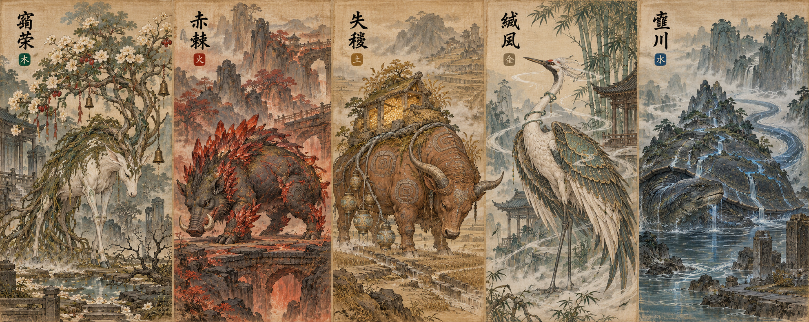

# PR #1 素材导入记录

来源：[Oii6111/xiuxian PR #1](https://github.com/Oii6111/xiuxian/pull/1)。

- 原始提交：`1232dcac04609bccbfe35782e8b2b9241371fa4c`。
- 原始作者：`chunchengzheng58-ctrl`。
- 原始提交标题：`Build Q-style 3D campaign with 20 bosses, minions and village stories`。
- 本次取回素材、配置、生成器及设计资料，未合并 PR 的整套战役程序，也未关闭或合并该 PR。
- 默认游戏仍从 `scenes/main.tscn` 启动水墨版漫游。

## 文件位置

| 内容 | 本地目录或文件 |
| --- | --- |
| 20 个 Boss 原生模型 | `assets/generated/bosses/b00.tscn` … `b19.tscn` |
| 10 类小怪原生模型 | `assets/generated/minions/m01.tscn` … `m10.tscn` |
| 6 位 NPC 原生模型 | `assets/generated/npcs/` |
| 模型名称与路径索引 | `assets/generated/model_manifest.json` |
| 五行 Boss 原画及提示词 | `outputs/boss-design-v1/` |
| 20 Boss 名录、剧情与设定 | `outputs/game-design-v2/` |
| Boss 配置 | `data/campaign_bosses.json` |
| 小怪与 NPC 配置 | `data/campaign_minions.json` |
| 配套建模源文件 | `scripts/campaign/creatures.gd`、`catalogue.gd` |
| 模型再生成工具 | `tools/build_models.gd` |
| 原 PR 的实现说明与参考截图 | `docs/BOSS_IMPLEMENTATION.md`、`MINIONS_AND_NPCS.md`、`screenshots/` |

模型是原 PR 的程序化 Q 版三维初模，保留原貌；这次没有重新美化，也尚未接入水墨版的五个 Boss 场景。

`BOSS_IMPLEMENTATION.md` 与 `MINIONS_AND_NPCS.md` 描述原 PR 中的战役设计和实现，作为来源资料保留，不能视为当前水墨版已经完成这些玩法的说明。

## 查看

在 Godot 中打开 `assets/generated/bosses/` 下任一 `.tscn`，即可查看并编辑对应模型。它们是自包含的原生网格场景，不需要启动原 PR 的战役程序。

原画：



## 重新生成

```powershell
Start-Process -FilePath 'F:\Godot_v4.7.2-stable_win64.exe' -ArgumentList @('--headless', '--path', 'F:\godot\xiuxian', '--script', 'res://tools/build_models.gd') -Wait -WindowStyle Hidden
```

重新生成会覆盖 `assets/generated/` 中的模型与索引；手动编辑过这些模型时，先保存自己的版本。
