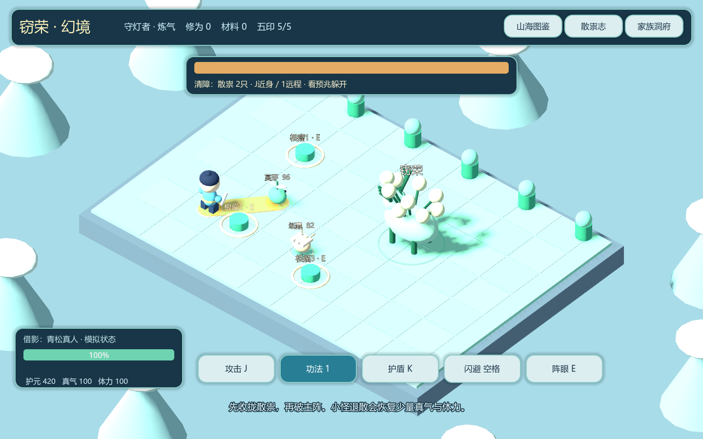
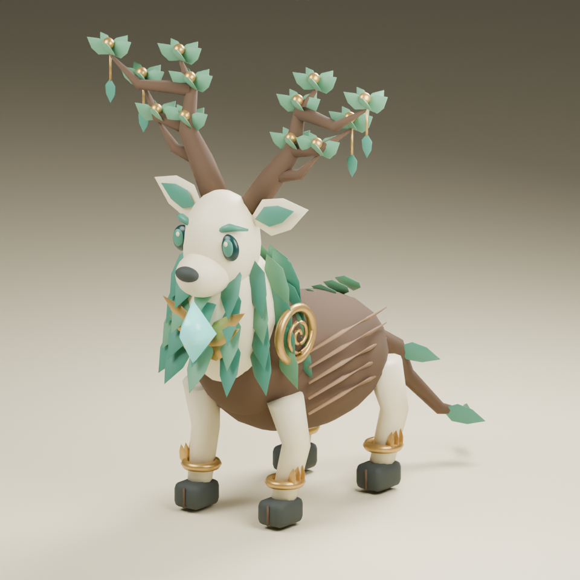
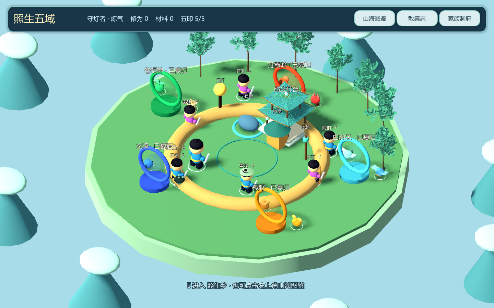
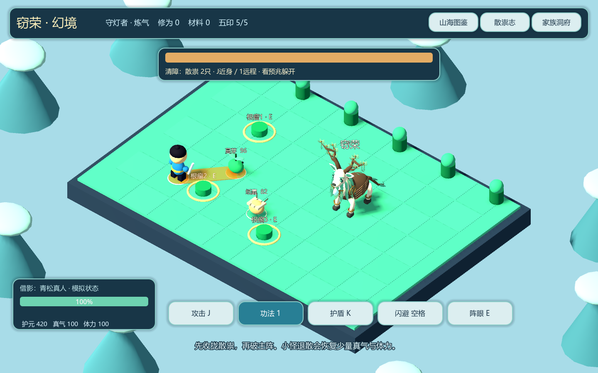

# 照生五域 V3 验证记录

日期：2026-10-30。以下为工程与实机检查，不代替真实用户试玩、临床验证或完整性能评测。

## 环境

- Godot 4.7.2.stable.official.ed1daf0bf
- Windows，Compatibility渲染，OpenGL 3.3
- 实机渲染设备：AMD Radeon 780M
- 新默认入口：scenes/campaign_main.tscn
- 新战役独立存档，测试使用work/twenty-boss内隔离文件，不覆盖玩家进度。

## 结果

| 检查 | 结果 |
|---|---|
| 新战役引擎断言 | 234通过，0失败 |
| 原版回归断言 | 61通过，0失败 |
| 模型场景导出 | 36个，0失败 |
| Boss运行时资料 | 20只，全部有可创建场景、招式与反制 |
| 小怪资料和实际模型 | 10种，五域各两种 |
| NPC模型和前后对白 | 6位 |
| 五印与终章 | 首通幂等、五印解锁验证通过 |
| 个人最佳 | 按难度/功法/模拟状态区分，更慢成绩不覆盖 |
| 暂停、护盾、闪避和命中 | 实际规则验证通过 |
| 故乡归巢 | 五域复归后10只和平小怪出现 |
| 截图 | town-v3.png、boss-v3.png已实机渲染并人工查看 |

## 覆盖内容

包括：唯一Boss ID、全部攻击预兆、圆/环/线/扇形命中与安全区域、攻击冷却、护盾/闪避在命中时有效、远距不能操作阵眼、20个Boss均可击败、真实地面预警生成、近距小怪攻击、清障后释放主祟、图鉴去重、六位NPC存在与对白入口、首通去重、重试不扣成长、JSON数值存档回读、未知模拟状态、快照固定、旧版记录与恢复流程回归。

渲染检查中修复了：地面上下层共面导致的闪烁、环境光天空贡献未显式配置、生命条默认灰色对比不足。绘制和判定共享攻击空间参数；角色半径带少量边界余量。

## 截图说明

截图用--preview创建独立演示数据，故乡展示已恢复五域、全部家园摆设与和平小怪；它不是某个真实家庭的健康记录。预览不持久化，生成预览不会给正常存档解锁五印。
截图是实际Godot运行画面，不是概念图。

## 仍需后续验证与制作

- 人类试玩：操作手感、不同构筑乐趣、关卡长度和信息负荷。
- 精修美术、骨骼动画、配音与音效、完整五域探索地图。
- 真实健康接口、专业规则审核与权限服务。
- 多人后端与网页导出包。当前不将本地演示冒充联网或真实医疗系统。

## 复现

PowerShell执行scripts/run_tests.ps1，指定-GodotPath。模型可用tools/build_models.gd重新生成；生成会覆盖对应原型场景，精修前请另存版本。

## 2026-10-30 Blender 精修批次

Blender4.5.14 LTS（官方SHA256匹配）、mcp-for-blender2.2.6、Godot4.7.2、Windows/AMD Radeon780M，GL Compatibility。已通过原生MCP读取插件状态、生成Sapling树、运行制作脚本并导出。遥测关闭。

本批次测试：战役234项、旧版61项、GLB资产48项，共343项通过，0失败。最终导入和测试日志未出现 ERROR / SCRIPT ERROR；编辑器测试资料改到D盘，修复初次导入时本机默认配置保存失败的环境问题。

资产检查覆盖三件GLB可导入、可见网格、材质、三角面预算、7骨骼保留、Idle/Walk/Attack存在且含真实变换轨道、采样播放确实改变骨骼、主祟攻击动作从Idle启动并自动回到Idle、运行模型加载器选用新资源和缺失文件时的回退入口。常规run_tests.ps1已包含此检查。

首批资产和尺寸见[Blender制作记录](BLENDER_PIPELINE.md)。实际模型四角度图位于screenshots/blender，主城四个方向图位于screenshots/town-{front,left,back,right}.png。画面均为实际渲染，概念图单独位于assets/references。

当前仍需人工试玩与美术审阅；没有完成其他19只Boss的同等级精修、完整动作库、材质烘焙、LOD制作、移动端/网页性能验收。上述通过项不能证明已达到3A成品质量。
