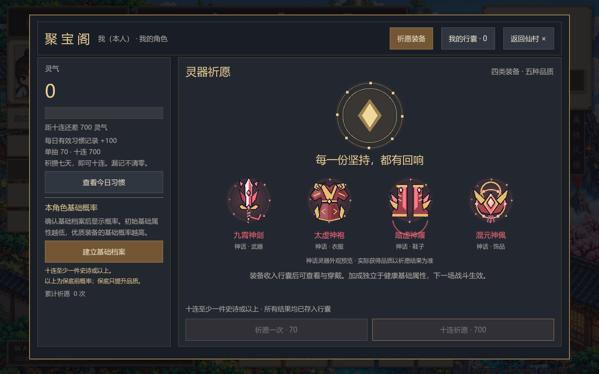
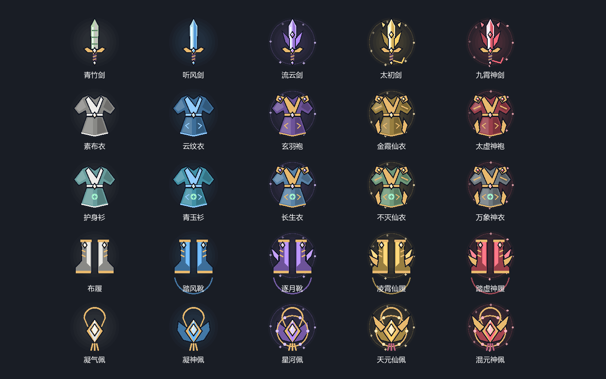

# 网页持续 Debug：2026-11-01

本轮固定分支：`codex/web-debug-series-20261101`，基于 `main` 的 `b8dddf0` 开始。后续这轮网页问题继续提交到此分支及其对应 PR，保持同一个 PR，不直接合并或发布线上。目标站点：<https://xiuxian.dshpond.com/>。

## 首批修复

- 游戏公开名称统一为用户指定的「疯狂修仙，中」：窗口/网页导出标题、登录页、开始页、健康入口及服务 API 标题。保留旧版用户目录，避免改名导致本机存档和登录缓存换位置。
- 仙村 E 键：在 80 像素内选择最近的建筑入口或 NPC。建筑进入对应页面，NPC 打开对话，底部明确提示「进入」或「对话」及对象。重新计算按键瞬间的位置；HUD 按钮取得焦点后仍然有效；弹窗期间不触发场景交互。鼠标和触控仍可使用。
- 桥边卡水：移动同时检查八像素角色脚底范围及完整移动路径，斜走受阻时沿岸滑动；物理碰撞滑动后再次校验。如果角色已在水里，自动返回上一处安全位置；安全位置失效时回到附近道路节点。
- 灵器外观：五种装备模板、五档品质显示对应的材质与纹饰，包含剑刃、护手、法袍、护肩、靴翼、宝石、玉佩及流苏。史诗以上增加动态光环。祈愿首页展示带名称的神话外观示例，抽取卡片及行囊详情使用实际装备模板与品质，详情增加大图。
- 抽卡概率、消耗、保底、属性和服务端账本规则沿用主分支。





## 验证与复测

本机结果：网页 Debug 回归 26 项、装备回归 59 项、玩法回归 46 项通过，触控回归全部通过，服务端 TypeScript 检查通过。

使用 Godot 4.7.2；以下 `--preview` 避免写入玩家存档。

```powershell
& 'F:\Godot_v4.7.2-stable_win64.exe' --headless --path . --script res://tests/equipment_test.gd -- --preview --skip-intro
& 'F:\Godot_v4.7.2-stable_win64.exe' --headless --path . --script res://tests/web_debug_test.gd -- --preview --skip-intro
& 'F:\Godot_v4.7.2-stable_win64.exe' --headless --path . --script res://tests/gameplay_test.gd -- --preview --skip-intro
& 'F:\Godot_v4.7.2-stable_win64.exe' --headless --path . --script res://tests/touch_controls_test.gd -- --preview --skip-intro
```

不加 `--headless` 运行 `web_debug_test.gd` 会把祈愿、NPC 对话、行囊详情和全装备图鉴截图保存到 `work/debug-series/`。回归覆盖真实 E 键事件、HUD 焦点、所有 NPC、弹窗阻止、全导航边双向通行、980 组岸边位移、落水恢复和实际装备详情。

部署同学合并后需要重新导出客户端，单独更新服务端源文件不会替换网页游戏包：

```powershell
Godot --headless --path . --export-release Web build/web/index.html
```

将本次导出的 HTML、JS、WASM、PCK 等整套文件同步到服务端 `WEB_ROOT`（默认 `build/web`），按现有流程刷新静态缓存。线上复测时点击游戏画布获取键盘焦点，靠近聚宝阁、村民分别按 E；沿桥两侧斜走并往返过桥；打开祈愿及行囊检查外观和穿戴。

## 验证边界

当前浏览器无法连接部署域名，本轮不声称已完成线上账号和微信链路实测。客户端功能通过本机 Godot 原生渲染及回归验证；本机尚未安装 Web 导出模板，下载官方 Web 组件时连接失败，因此未完成 Web 导出；部署同学需要按上面的流程导出并完成线上验收。本 PR 不携带本地账号、健康资料、微信凭证或未跟踪的旧功能输出。
