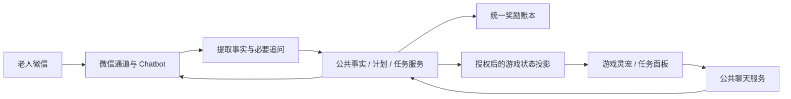

# 微信 Chatbot × 游戏灵宠联动对接说明

版本：业务联动 v1 草案 · 2026-10-31  
交付对象：微信 Chatbot、公共后端、Godot 游戏侧同学  
项目：家族修真录

> 当前完成的是游戏侧灵宠形象、选择、跟随、聊天界面及可选聊天 HTTP 适配器。微信对话提取事实、按事实启用任务、老人自述完成、跨端同步与服务端奖励尚未打通。本文中标注“待实现”的接口是双方联调约定，不能视为已有服务。

## 1. 本次确定的产品逻辑

老人主要在微信与 Chatbot 交流；年轻人在游戏中通过灵宠了解经授权共享的家人近况、任务和下一步安排。双方读取同一套服务端事实、计划和任务记录。

1. 老人提到身体状况时，Chatbot 整理为带来源的事实。允许共享的摘要与关怀提示可以出现在灵宠侧。
2. **只有已明确、属于这位老人、当前适用的内容，才能启用相应任务。** 没有当前用药依据时不创建服药任务；已有作息、饮食等约定可分别启用。
3. 老人明确确认当前存在既有用药计划，并补齐执行周期等必要信息后，才启用相关记录任务。
4. **正常任务以老人在微信中的明确反馈作为完成依据。** 唯一匹配任务后记为“本人自述完成”；默认不要求年轻人二次审批。信息含糊时向老人追问，不直接判定完成。
5. 灵宠负责呈现新任务、反馈进度和提供入口。事实落库、任务创建、状态更新、去重与奖励结算由共享后端执行。
6. 游戏里也可以与灵宠聊天；同一家庭的共享事实和任务保持一致。两人的私人聊天原文分别管理，只按授权共享必要信息。

例如：

> 老人：“我现在每天晚饭后，按原来的计划吃药。”  
> Chatbot：“您说的是现在每天晚饭后都有这个用药安排，对吗？”  
> 老人：“对。”  
> 后端确认当前计划，创建对应日期和时段的记录任务。  
> 灵宠：“爸爸有一项晚饭后的用药计划记录，我会帮你留意进度。”  
> 老人晚些时候：“今天晚饭后的药已经按计划吃了。”  
> 后端匹配该任务，记录 `completed / wechat_self_report`，执行一次结算。  
> Chatbot：“今天这次记录已记上。”  
> 灵宠：“爸爸已反馈完成今天晚饭后的用药计划。”

说明：“本人自述完成”表达的是老人反馈的记录状态，不表示系统已用设备或医学证据验证实际服药。

## 2. 游戏侧现状与差距

| 能力 | 当前状态 | 对接时处理 |
|---|---|---|
| 四只灵宠选择、昵称、免费切换、账号保存 | 已实现 | 直接复用 |
| 村庄跟随、点击交互、说话与庆祝表现 | 已实现 | 直接复用 |
| 聊天面板、输入、快捷提问、导航按钮 | 已实现 | 直接复用 |
| 可选 POST 聊天适配器、超时回退、会话隔离 | 已实现 | 按第 7 节兼容接入 |
| 今日任务、家人近况、下一步回答 | 已实现本地规则版本 | 目前只读取本地两个任务开关/记录，不读取微信 |
| 从微信对话提取并确认当前事实、启用计划 | 待实现 | Chatbot + 公共后端 |
| 动态任务实例、日期/时段、计划版本 | 待实现 | 公共后端 + 游戏动态任务展示 |
| 微信自述完成后自动同步任务及奖励 | 待实现 | 公共后端 + 游戏同步适配 |
| 游戏账号与老人微信的服务端绑定 | 待实现 | 公共后端 + 两端授权入口 |
| 微信小游戏发布与运行适配 | 当前未完成 | 本项目当前是 Godot 桌面原型；另行验证目标运行环境 |

当前游戏仍有“家属在游戏内确认本地演示记录”的流程。它描述的是现有原型，**正式联动的默认规则以本文件的微信本人自述为准**。接入云端任务时，游戏侧必须调整这部分入口。

现有聊天 API 返回任务文字，并不会自动产生任务对象或更新游戏任务状态；任务同步需要另外接通第 8 节的数据接口。

## 3. 系统关系与分工



| 负责人 | 最小交付 |
|---|---|
| 微信 Chatbot 同学（D） | 收发消息、辨别说话对象与时间、提取候选事实、必要追问、提交结构化事件、展示最终处理结果；保留可追溯的来源引用 |
| 公共后端同学（C） | 账号与绑定、授权、事实/计划/任务的权威存储、任务启用规则、状态版本、事件去重、服务端结算、游戏读取接口 |
| 游戏侧同学（B） | 复用灵宠与聊天界面；绑定老人档案；新增动态任务读取、前台刷新、状态展示与提示；接入权威奖励结果 |

如果 Chatbot 同学暂时同时负责后端，也要保留这三层边界。微信与游戏是两个入口，服务端任务库是共同依据。战斗系统本次无需参与任务判定。

## 4. 身份、授权与对象归属

现有产品结构为：一个年轻人账号 + 本人角色 + 最多两位老人。灵宠属于年轻人账号，不占老人位置。

需要建立以下映射：

| 字段 | 含义与规则 |
|---|---|
| `account_id` | 年轻人服务端账号 ID；服务器从已验证会话确定权限 |
| `elder_id` | 服务端稳定的老人档案 ID；两位老人必须不同 |
| `game_member_id` | 游戏现有老人角色 ID；绑定时映射到 `elder_id`，不覆盖原角色存档 |
| `binding_id` / `binding_version` | 微信身份与老人档案的有效绑定及版本 |
| 微信发送者标识 | 由通道适配层提供并核验；留在服务端，游戏不据此自行认领档案 |
| `source_message_id` | 通道适配层映射的稳定消息 ID，用于来源追溯和防重 |

本人的 `game_member_id="self"` 只能在对应账号内解释，不能把所有账号的 self 合并成一个人。

建议绑定流程：年轻人在指定老人位置生成一次性邀请 → 老人在自己的微信确认对应档案和共享范围 → 后端记录绑定与授权 → 游戏查询到有效绑定。接口地址建议见第 8 节。

首版一位老人对应自己的微信身份；不依据“爸爸/妈妈”称呼、相同姓名或模糊语境自动绑定，也不将一个聊天会话中的两位老人资料混存。

共享范围分别记录：

- `tasks`：任务、完成状态和必要的执行安排。
- `health_summary`：老人明确允许共享的简短身体状况摘要。
- 微信聊天原文、完整病历、原图、精确用药资料留在健康/聊天域；游戏默认只接收必要投影。

解绑或撤回授权后，后端停止新的共享、处理与结算；队列中的事件应用前再次检查绑定版本。游戏清除相应共享缓存。已有完成记录与历史奖励的保留按已确定的产品规则处理，不因连接中断自动清零。

## 5. 按已确认事实启用任务

### 5.1 “是否有用药计划”与“今天是否完成”分开

| 情况 | 当前用药状态 | 是否创建服药任务 |
|---|---|---|
| 从未聊过、信息不足 | `unknown` | 不创建；不能宣称“没有用药” |
| 已明确目前没有用药安排 | `no_current_plan` | 不创建；可展示已确认的作息/饮食任务 |
| 已明确当前有既有计划，但周期等信息不全 | `details_pending` | 暂不创建正式重复任务，向老人补问 |
| 当前安排及必要信息已确认 | `active_plan` | 按计划生成对应日期/时段的实例 |
| 今天没吃、还没吃，但原计划仍有效 | 仍为 `active_plan` | 只更新今天的反馈，不关闭后续计划 |
| 提到停药、换药或计划变化 | `change_pending` | 核实变化，暂停生成受影响的新实例；不由 AI 建议停、加、减药 |

“我没吃药”有歧义：可能是目前没有计划，也可能只是今天没完成。已有用药上下文时应追问含义，不能直接关闭计划。

“以前吃过”“朋友在吃”“听说某种药”“药买回来了”以及药盒照片，都不能单独确认这位老人当前存在每日服药计划。

### 5.2 任务激活条件

服务端应同时检查：

1. 有效绑定与对应共享授权仍然存在。
2. 事实确实属于当前老人，且指向现在而非过去、他人或假设。
3. 任务具有明确、可理解的实际内容，并已得到老人确认。
4. 周期、起始日期及所需时段等必要字段齐全；缺什么就补问什么，不猜测次数和时间。
5. 生成规则、计划版本和完成方式已固定。

明确、完整的本人陈述本身可以作为确认；不要求每条清楚的消息都重复问一遍。只有归属、当前适用性、周期或指代等不明确时才追问。

作息、饮食同样按确认过的习惯安排启用。没有任何明确约定时，任务列表可以为空，灵宠引导了解生活习惯；不为凑每日数量自动填入泛化任务。

身体不适可以形成经授权的近况摘要或关怀提示；症状本身不能直接生成服药任务、药物名称、剂量或治疗要求。

### 5.3 计划与实例

- `care_plan`：长期或一次性安排。状态建议为 `details_pending / active / paused / ended`。
- `task_instance`：某日某时段的一次任务。由服务端创建稳定 ID。
- 同一计划同一次执行的唯一键建议为 `(plan_id, occurrence_key)`，例如 `2026-11-01:after_dinner`。每个实例固定其 `plan_version` 与规则版本。
- 计划变化通常作用于未来实例；旧完成记录保留。取消旧待办时必须同步取消结果，不能只从接口中悄悄消失。
- 服药类任务建议展示“记录晚饭后的既有用药计划”等必要内容。精确药名与用量是否共享，另按健康资料授权决定。

## 6. 微信反馈如何完成任务

默认 `completion_method="wechat_self_report"`。

1. Chatbot 收到老人反馈，先从后端查询该老人相应日期的有效任务。
2. 核对反馈是肯定完成、属于本人、日期明确，并能唯一匹配到一个任务实例。
3. 如果存在多个药物/时段，或“吃过了”指代不明，向老人追问对应哪次；澄清记录保留来源，任务暂不完成。
4. 唯一匹配后提交 `task_completion_reported` 事件。后端复核绑定、任务归属、日期和状态后原子更新。
5. 后端返回应用成功后，Chatbot 才回复“已经记上”。年轻人无需再点一次确认。
6. 游戏从统一任务接口读取同一结果，显示“老人已反馈完成”，可附“本人自述”标识。

建议任务状态：

| 状态 | 含义 | 游戏展示 |
|---|---|---|
| `pending` | 已启用，尚无明确完成反馈 | 待反馈 |
| `completed` | 后端已接受匹配的本人完成自述 | 老人已反馈完成 |
| `skipped` | 老人明确表示本次跳过 | 本次未完成 |
| `cancelled` | 计划取消/暂停等使该待办失效 | 已取消，并说明原因 |
| `expired` | 已超过配置的反馈窗口 | 暂未收到本次反馈 |

未读消息、没有照片、没有回复，不等于确认老人没有做。补记按模板允许范围处理，使用实际发生日期而非收到消息的日期，不能将“昨天完成”记成今天。

收到完成自述但找不到对应有效任务时，先保存为待匹配生活记录或补问；不临时创建一条有奖任务来追认完成。

老人更正先前反馈时追加纠正事件并追问清楚，保留原记录。涉及已结算奖励的更正由公共后端按单独规则处理，客户端不自行扣回或重发；该规则需在正式结算上线前冻结。

## 7. 已有聊天 API：可直接兼容的部分

详见同目录 `COMPANION_API.md`，实现位于 `scripts/companion_client.gd`。以下描述已核对当前代码。

- 设置 `XIUXIAN_COMPANION_API_URL` 为完整 POST 地址；路径由双方配置，建议 `/api/v1/companion/chat`。
- 只设置聊天 URL **不会发送游戏账号令牌**。只有已约定身份校验且显式设置 `XIUXIAN_COMPANION_AUTH_ORIGIN` 为匹配的协议/主机/端口，当前适配器才附带游戏会话。
- 本机账号会话目前不具备天然的跨服务通用性；正式接入须由公共后端统一验证或另做最小权限令牌交换。模型密钥保留在服务端。
- 每次消息具有 `request_id` 和 `conversation_id`；回复须原样回传这两个字段。
- 现有客户端 context 的 `source="local_game"`，只可作演示上下文，不能覆盖云端事实或作为云端发奖依据。
- 聊天记录当前仅在内存保存最近 40 条，退出账号时清理；它不是微信与游戏共享记忆的数据库。

现有请求示意，完整 context 结构见原 API 文档：

```json
{
  "schema_version": 1,
  "request_id": "req-chat-001",
  "conversation_id": "conv-game-001",
  "channel": "godot",
  "account_id": "account-child-001",
  "companion": {"id": "gourd_dragon", "nickname": "团团"},
  "message": "爸爸今天的任务怎么样？",
  "context": {
    "source": "local_game",
    "as_of_date": "2026-11-01",
    "active_member_id": "elder-local-001",
    "characters": []
  }
}
```

```json
{
  "request_id": "req-chat-001",
  "conversation_id": "conv-game-001",
  "reply": "爸爸已经反馈完成今天晚饭后的用药计划记录。",
  "animation": "celebrate",
  "actions": [{"id": "family", "label": "查看家人近况"}]
}
```

回复为 1—2000 字普通文字；`animation` 允许 `idle / talk / celebrate`。导航动作最多三个，允许 `record / family / health / treasure / equipment / boss`。现有解析器会忽略任务对象、奖励字段等额外内容，不能通过给聊天回复附加 `tasks` 或 `reward` 来完成业务同步。

当前导航 `record` 仍打开本地演示确认页。云端联动发布前，游戏侧需要把已绑定老人的入口改接新的任务列表，避免误走本地奖励流程。

## 8. 待实现的业务接口

以下路径为建议约定，**当前游戏与服务端尚未实现这些接口**。正式联调前由双方冻结地址、身份验证和字段版本。

| 接口 | 调用者 → 提供者 | 用途 |
|---|---|---|
| `POST /api/v1/family/binding-invitations` | 游戏 → 公共后端 | 为指定老人角色创建短时、一次性邀请 |
| `POST /api/v1/integrations/wechat/bindings/confirm` | 微信服务 → 公共后端 | 核验发送者、邀请与同意范围，建立绑定 |
| `GET /api/v1/integrations/wechat/tasks?binding_id=...&business_date=...` | 微信服务 → 公共后端 | 只查询有效绑定老人的当日任务，辅助匹配自述 |
| `POST /api/v1/integrations/wechat/events` | 微信服务 → 公共后端 | 上报已确认计划、完成反馈或计划变化 |
| `GET /api/v1/companion/state?business_date=...` | 游戏 → 公共后端 | 获取有权查看的完整家庭任务/近况快照 |

微信服务使用专用、限权的服务端凭证，不下发给游戏。游戏读取接口验证玩家身份与家庭权限。上述接口里的 ID 和来源引用均需服务器核验，不能只因客户端声称某位老人是谁就接受。

### 8.1 微信确认当前计划：结构化事件示例

事件由 Chatbot 的已确认业务结果产生；不直接发送任意 LLM 文本作为可执行任务。

```json
{
  "schema_version": 1,
  "event_id": "evt-plan-confirmed-001",
  "event_type": "care_plan_confirmed",
  "binding_id": "binding-elder-001",
  "binding_version": 3,
  "elder_id": "elder-server-001",
  "source_message_ids": ["wx-msg-100", "wx-msg-101"],
  "occurred_at": "2026-11-01T10:00:00+08:00",
  "payload": {
    "external_plan_ref": "wx-plan-dinner-001",
    "kind": "medication",
    "current_use_confirmed": true,
    "elder_confirmed": true,
    "schedule": {
      "timezone": "Asia/Shanghai",
      "frequency": "daily",
      "slots": [{"id": "after_dinner", "label": "晚饭后"}]
    },
    "effective_from": "2026-11-01",
    "completion_method": "wechat_self_report"
  }
}
```

`external_plan_ref` 是微信服务为该已确认安排保持的稳定引用，后端映射到唯一 `plan_id`。相同安排的重试不创建第二份计划。来源消息由健康/聊天域保存，游戏不接收原文。

该示例成立的前提是老人确实确认了“当前、每日、晚饭后”的安排；只有药名、照片或模糊的“在吃药”时不能填出此结构。计划不必强行转换为一个猜测的钟点；执行时段可保留为已确认的“晚饭后”。

后端返回：

```json
{
  "event_id": "evt-plan-confirmed-001",
  "event_status": "applied",
  "plan_id": "plan-server-001",
  "plan_version": 1,
  "revision": 104,
  "created_task_ids": ["task-20261101-dinner-001"]
}
```

### 8.2 老人明确反馈完成

```json
{
  "schema_version": 1,
  "event_id": "evt-completed-001",
  "event_type": "task_completion_reported",
  "binding_id": "binding-elder-001",
  "binding_version": 3,
  "elder_id": "elder-server-001",
  "source_message_ids": ["wx-msg-120"],
  "occurred_at": "2026-11-01T19:30:00+08:00",
  "payload": {
    "task_id": "task-20261101-dinner-001",
    "observed_business_date": "2026-11-01",
    "answer": "completed",
    "completion_method": "wechat_self_report"
  }
}
```

后端在一次事务中核对任务、更新状态、记账并生成回执，随后返回：

```json
{
  "event_id": "evt-completed-001",
  "event_status": "applied",
  "revision": 105,
  "task": {
    "task_id": "task-20261101-dinner-001",
    "status": "completed",
    "completion_method": "wechat_self_report"
  },
  "reward": {
    "receipt_id": "receipt-elder001-20261101",
    "recipient_elder_id": "elder-server-001",
    "qi_delta": 100
  }
}
```

这里的 100 灵气示例仅适用于当日首次符合奖励规则的记录；当天已有有效结算时该次新增奖励为 0。重复事件回放应返回原回执和 `event_status="duplicate"`，不能再入账；展示层也不能把回执中的 delta 再次累加。

### 8.3 游戏读取共享快照

首版建议每次返回完整授权快照。两位老人数据量较小，可以先保证一致性，再讨论增量或推送。

```json
{
  "schema_version": 1,
  "revision": 105,
  "server_time": "2026-11-01T19:30:02+08:00",
  "business_date": "2026-11-01",
  "timezone": "Asia/Shanghai",
  "members": [{
    "elder_id": "elder-server-001",
    "game_member_id": "elder-local-001",
    "binding_version": 3,
    "display_label": "父亲",
    "medication_context": "active_plan",
    "health_summary": null,
    "tasks": [{
      "task_id": "task-20261101-dinner-001",
      "plan_id": "plan-server-001",
      "plan_version": 1,
      "occurrence_key": "2026-11-01:after_dinner",
      "kind": "medication",
      "title": "记录晚饭后的既有用药计划",
      "status": "completed",
      "completion_method": "wechat_self_report",
      "completed_at": "2026-11-01T19:30:00+08:00"
    }],
    "next_action": {
      "text": "今天这项计划已反馈完成，可以看看其他安排。",
      "type": "view_other_tasks"
    },
    "reward_summary": {
      "daily_qi_earned": 100,
      "latest_receipt_id": "receipt-elder001-20261101"
    }
  }]
}
```

`health_summary` 默认为空；老人同意共享身体近况时，可返回已授权的短摘要及更新时间。不得让客户端自行从原始聊天中推断共享权限。

`revision` 为该账号共享投影的单调版本。缓存按账号、业务日期分别隔离；仅接收当前登录身份和绑定范围对应的结果，丢弃旧版本/旧会话回复。完整快照替换的是云端任务投影，不得覆盖原有角色、健康基线、装备或试炼存档。

## 9. 同步、失败与奖励的一致性

### 9.1 游戏侧刷新

待新增：登录完成、绑定完成、打开灵宠/任务页、切换角色、从后台恢复时立即查询。前台联网时建议每 15 秒刷新；聊天回复后可再主动刷新一次。

联调验收目标：后端已成功应用微信事件，且游戏持续前台联网时，15 秒内显示同一任务版本。离线或网络异常时显示最近同步时间和“等待同步”，恢复后主动重取；不能承诺离线设备实时更新。

同步不依赖年轻人主动向灵宠提问。老人更新任务后，即使游戏聊天框一直没打开，游戏也应在刷新后得到结果；同一提示按任务/版本去重，避免反复弹出。

### 9.2 必须统一的规则

- 微信事件使用稳定 `event_id` 和消息来源引用，重试保持同一个编号；消息重复投递与重复说“完成了”均不能重复创建或结算同一任务。
- 所有时间包含时区，业务日期首版统一为 `Asia/Shanghai`。同时保存实际发生时间与服务端接收时间，补记不挪到接收日。
- 写入与结算前再次核对绑定/授权版本。队列重放不能越过解绑。
- 微信回复发送失败时只重试通知；已经成功的任务/奖励不再执行一次。
- 奖励沿用现有每日规则：每位角色每日首次符合条件的习惯记录获得 100 灵气，每日最多一次；增加用药次数、消息次数或重复提交不增加额度。
- 账本按真实对应角色记账，两位老人、本人角色及灵宠的归属清楚；最终余额来自权威账本。

### 9.3 本地演示与正式任务的切换

云端联动启用后，已绑定老人的正式任务默认在微信自述完成。游戏展示状态和来源，不能继续用原本的本地 `record_task()` 把云端任务直接确认或再发一次本地奖励。

游戏需新增单独的云端任务投影与账本适配，改造当前 `medication / planned_record` 两个布尔记录入口。未完成这一步前，不应把既有本地演示记录冒充微信同步结果，也不应静默将其批量上传成云端完成事件。

聊天服务断线时可保留本地向导介绍玩法，但涉及已绑定老人时，必须说明共享状态暂未刷新，不能用本地旧开关代替云端状态宣称任务完成。

## 10. 最小联调顺序

1. 用一位测试老人完成账号、游戏老人角色和微信发送者的绑定；全程使用独立测试数据。
2. 微信确认一条已有生活习惯，公共后端创建一个任务；游戏查询接口能看到稳定的同一 `task_id`。
3. 老人在微信明确说完成，服务端更新状态；游戏自动刷新后显示“本人自述完成”。不需要年轻人再确认。
4. 验证未知用药不生成服药任务；补齐并确认当前计划后才生成；同日不同任务共享奖励上限。
5. 再接共享摘要、灵宠主动提示、第二位老人以及断网/解绑恢复。

第一轮可以固定脚本和模拟回复验证业务链路，无需等待复杂的陪聊人格或完整微信小游戏发布适配。

## 11. 验收用例

| 场景 | 必须观察到的结果 |
|---|---|
| 未绑定就发来健康信息 | 先完成身份/授权流程；不认领到任意家人档案 |
| 用药状态未知 | 不生成服药任务，不宣称“老人不用药” |
| 已明确无用药计划，已确认饮食/作息安排 | 只出现适用的生活习惯任务 |
| 提到他人、以前用药或药物话题 | 不启用当前老人的服药任务 |
| 当前用药已确认，周期/时段未清楚 | 补问必要信息，暂不创建重复任务 |
| 当前既有计划与执行安排已确认 | 生成唯一任务，来源可追溯 |
| 微信明确完成且唯一匹配 | 记为 completed + wechat_self_report；游戏无需二次审批 |
| “吃过了”但有多个候选任务 | 向老人澄清，暂不批量完成 |
| “今天还没吃” | 不判完成，也不自动关闭长期计划 |
| 没有回复 | 展示待反馈/暂未收到，不推断事实上的未完成 |
| 昨天完成的延迟消息 | 按允许的补记规则匹配昨天，不记到今天 |
| 同一消息重发、同一任务重复报完成 | 单任务、单结算；返回可重放回执 |
| 当天第二个不同任务完成 | 状态可以更新，灵气不突破每日上限 |
| 父亲消息与母亲消息交错 | 两位老人的计划、任务、奖励和摘要互不串用 |
| 年轻人未打开聊天框 | 前台联网时仍按刷新机制得到任务更新 |
| 微信结果已落库但回复失败 | 只补发通知，不再结算 |
| 解绑后收到旧队列消息 | 拒绝继续共享和新增结算；游戏清理共享缓存 |
| 断网、乱序回复、切换账号 | 保留正确归属和版本，不把旧回复显示给新账号 |
| 原本地演示确认按钮仍可见 | 不得改变已绑定老人的云端任务或重复增加正式奖励 |

## 12. 双方接入前需要确认的四项

1. **后端归属与地址**：谁提供统一事实/任务/账本服务、部署地址、各端权限与令牌验证方式。
2. **绑定和共享范围**：老人 ID、游戏角色映射、微信身份核验与撤回流程。
3. **任务模板参数**：哪些生活习惯首版支持、周期/时段要求、补记范围、计划变更和反馈纠正规则。
4. **接口冻结与联合验收**：以上新增接口的实际字段、错误码和快照版本约定，以及同一测试老人从计划启用到奖励显示的完整演示。

本轮文档交付不更改游戏脚本、现有存档、账号数据库或微信服务。当前可复用的聊天层参考 `COMPANION_API.md`；正式联动还需按本文件补齐游戏与后端两侧能力。
