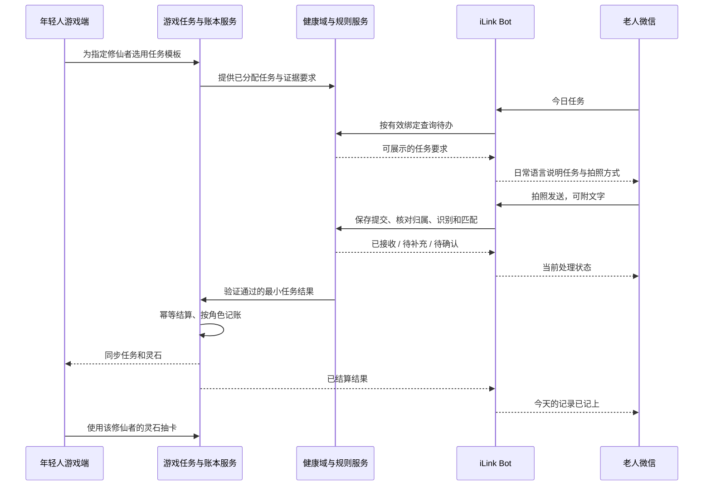

# 微信 iLink AI Bot 信息入口方案

更新日期：2026-10-31。关联：[产品设计 v2](../家族修真录-设计文档-v2.md) §3、§9、§19、§20。

本方案确定产品入口与验收标准。C 已实现本地业务绑定、授权、任务实例、验证结果接收、事务结算及通知接缝，见 [团队合并指南](BACKEND_INTEGRATION.md)。实际微信通道、健康证据核验与 AI 仍由 D 接入。已有 `health-entry/` 是网页资料识别原型；Godot 内核与本地模拟演示不代表真实微信链路已经接通。

## 1. 产品目标与两端分工

年轻人用游戏安排健康任务、处理确认和抽卡；老人用自己的微信与 AI Bot 聊天，查看待办、拍照提交各类资料并获得简短反馈。任务通过验证后，灵石发给这位老人对应的修仙者，年轻人在游戏里使用。

老人不用安装新应用或理解抽卡规则。Bot 回复优先说明“已记上”“需要补一张清楚的照片”“正在等家人确认”，避免用游戏成绩评价健康。游戏侧显示任务进度、灵石和可追踪的结算结果。

## 2. 首次绑定

1. 年轻人在游戏中选择修仙者，点击“绑定老人微信”，生成有时效、一次性的业务邀请。
2. 在官方支持的流程中展示 iLink 授权二维码，老人用自己的微信扫码并在手机确认。该步骤建立 Bot 通道，不自动代表同意上传或共享健康资料。
3. 产品通过该通道的已授权账号、实际发送者与有效邀请核对归属；老人确认自己对应哪位修仙者。邀请过期、发送者不符或已绑定其他档案时，不自动覆盖绑定。
4. 老人明确同意资料处理、AI 识别和家庭内共享范围后激活业务绑定。年轻人侧显示“微信已连接 / 资料授权已确认 / 可以接收任务”，分别展示，避免混为一个状态。
5. 老人主动发送“今日任务”，Bot 回应与这条绑定对应的待办，完成首次链路验证。

初版限定一位老人、一条有效微信绑定、一位修仙者；同一童子可以管理多位老人。多人共用微信、代传多位老人资料和群聊不纳入首版，改用家属在网页中明确选择代传对象。具体二维码呈现位置和账号可用范围须实测确定。

解绑或撤回资料授权后，立即停止新的资料处理和结算，取消尚未发出的任务消息；队列中的提交在验证、结算前再次检查授权。已到账奖励不因通道断开而消失，尚未结算的提交须重新授权并复核，不静默继续处理。删除申请覆盖本服务保存的原图、对话与识别结果，不能承诺删除微信平台或其他接收方已保存的副本。

## 3. 可提交资料与任务证据

| 老人微信提交 | 可支持的用途 | 不能据此推断 |
|---|---|---|
| 体检报告，可多张 | 提取报告指标，确认后建立或补充本赛季基线 | 不直接替老人选职业、诊断或发奖 |
| 复诊资料、用药单 | 已有资料归档，核对既有计划，完成指定资料提交任务 | 不自动改变用药、判定康复或开启飞升 |
| 当日步数截图 | 完成允许截图验证的“上传今日步数记录”等任务 | 不证明实际散步时长，不自动完成所有运动任务 |
| 按计划测量的仪器屏幕照片 | 记录一次测量，匹配允许照片凭证的任务 | 不等于可信设备直连，不因读数高低增减奖励 |
| 药盒、用药记录照片 | 指定资料归档或补充人工确认依据 | 单张药盒图不能证明按时服药 |
| “今天完成了”等文字 | 查询、说明或模板允许的自述提交 | 不等于照片/设备验证 |

首版支持图片和文字，图片为主。语音、文件和视频即使协议存在类型定义，也须分别验证接收、解码、识别和交互后再纳入产品范围。

每个任务模板必须定义：现实要求、适用计划、允许的证据、所需日期/时间信息、验证方式、周期、奖励引用。年轻人只能选用适用模板和调整允许的时间安排，不能自定灵石奖励或突破每日上限。任务派发时固定模板与规则版本，避免中途改模板导致同一份凭证得到不同结果。

## 4. 老人侧最小交互

首版使用普通文字与图片，不依赖自定义卡片、菜单按钮、群聊或主动推送。

> 老人：今日任务
>
> Bot：今天有一项记录：上传今日步数。请发送带有日期和步数的截图，按您原来的活动计划完成即可。
>
> 老人：［今日步数截图］
>
> Bot：照片收到了，我正在核对今天的记录。
>
> Bot：今天的步数记录已记上，家人那边也会同步看到。

最后一条只在验证和结算完成后发送；如果只完成接收，不能提前宣布任务完成。游戏端再显示实际灵石增量。

| 情况 | Bot 行为 | 游戏侧状态 |
|---|---|---|
| 没有绑定 | 引导完成业务绑定，不处理健康图片 | 未绑定 |
| 没有待办却收到资料 | 询问是否作为资料归档，不擅自创建有奖任务 | 不改变资源 |
| 无法识别或日期缺失 | 指出缺少的信息，允许补拍，不让老人重复做健康行为 | 待补充 |
| 多个候选任务 | 展示简短编号让老人选择，再核验适用性 | 识别中 / 待补充 |
| 需家属复核 | 告知已转家人确认，游戏内生成待处理项 | 待确认 |
| 重发同一凭证或已完成实例 | 返回已有处理结果，不重复记账 | 保持原完成状态 |
| 发奖暂时失败 | 说明记录已通过、正在同步，保留自动重试 | 待结算 |
| 会话失效或通道限流 | 保存处理结果，提示连接状态；允许再次发消息查询 | 任务结果与通道状态分开 |

Bot 不要求老人为了获得更多灵石重复测量、超计划运动或增加服药。不会聊天不算任务失败，家属可用代传入口协助。

## 5. 从提交到资源的规则

1. **先接收**：保存渠道账号、发送者、稳定消息标识及媒体引用，再推进轮询游标。尚未授权的内容不进入健康识别处理，按拒绝接收策略处理缓存。
2. **再识别**：AI 输出资料类型、识别字段、候选任务和置信度；这些都是候选结果，不是完成事件或发奖命令。图片和文字中的指令也不能改变验证策略。
3. **匹配实例**：服务端核对有效绑定、修仙者、任务实例、模板版本、允许的来源、完成时间窗和凭证。图中文字可用作待核实信息，不能单靠姓名或日期识别结果认定归属与真实性。
4. **处理确认**：不清楚的内容转补充或人工确认；采用家属确认的结果按该验证方式计奖，不把所有人工通过都当成照片或设备级验证。
5. **验证达成**：通过后生成稳定的任务完成结果。同一实例只完成一次；跨渠道共用同一去重账本，照片指纹仅作重复提示，不能作为唯一真实性判断。
6. **事务结算**：检查实例唯一性、24 小时同类事件限制、当天额度和归属，在同一事务写入完成记录、资源增量及限额计数。通知另行可靠重试。
7. **两端回执**：游戏读权威资源快照，Bot 根据结算结果回执。微信发送失败不会触发重新发奖，游戏暂时离线也不丢失已记账结果。

资源沿用 v2：健康任务的灵石和经验属于修仙者，陪伴类功德属于童子。照片验证初始倍率 80%，家属确认 60%，自行申报 30%；微信不额外提高倍率。以无补偿、无上限截断、向下取整为例，基础 8 灵石的照片任务可得 6 灵石，不能显示为设备验证的 8 灵石。补偿与每日上限的具体计算顺序须在规则版本中统一，不能由 Bot 口头承诺。

首版健康任务验证通过后自动结算一次，游戏的“领取”不得再发同一份奖励；其他未通过自动结算的游戏任务可沿用领取请求，但必须共用幂等账本。

## 6. 数据与服务边界

| 对象 | 归属与必要字段 |
|---|---|
| `binding` | 健康域：通道账号、发送者、老人档案、修仙者、童子账号、授权版本、有效状态；通道凭证单独存储 |
| `task_instance` | 游戏任务服务：实例 id、修仙者、模板/规则版本、周期与时间窗、允许证据、完成/结算状态 |
| `submission` | 健康域：提交 id、绑定、渠道消息关联、图片/文本引用、候选任务、识别与确认状态；支持多图补充 |
| `verified_task_result` | 跨域最小结果：事件 id、任务实例、修仙者、验证方式、完成时间、规则版本、有效授权引用；不含原图/读数 |
| `settlement` | 游戏域：稳定结算 id、实例唯一键、角色归属、奖励增量、限额记录、回执发送状态 |

`channel=wechat_ilink` 与 `source=photo` 等事实来源分开。协议消息标识保留通道作用域，按原始格式稳定保存，避免数字精度损失；同一 iLink 消息重投必须命中已有提交。`task_completed` 只在验证后输出；微信收到图片时仅创建提交。

服务端建议划分 `channels/wechat_ilink/`、`health/`、`rules/`、`game/`。健康识别候选与原始内容不进入游戏命令、进程内 EventBus、社交名片或公共日志。Godot 仅安排任务和显示游戏投影，通道 token、会话上下文及媒体解密凭证不下发客户端。

每位老人独立隔离对话历史、媒体和模型上下文；重新绑定后不得复用另一位老人的上下文。若选用官方 OpenClaw 插件，其引用消息缓存、媒体缓存与模型服务中的资料也必须纳入本产品的保存期限和删除策略，不能只清理业务数据库就声称已清除所有副本。

## 7. 官方能力依据与待实测项

查阅日期：2026-10-31。

- [腾讯官方接入包与使用说明](https://github.com/Tencent/openclaw-weixin)：扫码授权、文本/图片等消息、长轮询和账号/会话隔离。
- [腾讯官方协议参考](https://github.com/Tencent/openclaw-weixin/blob/main/docs/protocol.md)：HTTPS/JSON、二维码授权、`getupdates`、`sendmessage`、媒体获取与会话 `context_token`。
- [npm 官方接入包](https://www.npmjs.com/package/@tencent-weixin/openclaw-weixin)：`@tencent-weixin/openclaw-weixin`，供锁定后续接入依赖与版本。

官方协议参考明确区分客户端类型、客户端行为与完整服务端契约。不能因为类型里有群聊字段，就承诺已支持群聊；也不能把可调用发送方法理解为无限制主动触达。

前期需要真实账号验证：微信版本和账号资格、二维码授权与业务绑定体验、图片下载和识别、会话可回复条件、限流/掉线/重新授权。运行时可以选择官方 OpenClaw 插件或独立协议适配器；选择哪一种不改变健康域、任务验证与游戏账本的职责。接入依赖的最低版本与保存策略按实际锁定版本记录，不在产品文档里写成永久约束。

## 8. 最小 Demo 与验收

| 场景 | 验收结果 |
|---|---|
| 年轻人为两位老人分别创建角色并绑定 | 微信提交不会进入另一位修仙者的任务或钱包 |
| 游戏选用任务，老人发送“今日任务” | 只展示本人当前有效待办及可理解的凭证要求 |
| 老人发符合模板的当日照片 | 接收、验证、结算、微信回执与游戏资源同步可追踪 |
| 同一消息重投、照片重发、网页再传 | 同一任务实例只发奖一次 |
| 模糊图片、多个候选、不足以证明达成 | 追问或待确认，不自动完成或发奖 |
| 文字自述和设备照片 | 不被提升为可信设备直连倍率 |
| 授权撤回、解绑或账号归属冲突 | 后续提交和待结算处理被拦截，给出明确状态 |
| 结算成功但微信回执失败 | 资源保持一笔，重试发送已有结果 |
| 接入不可用 | 使用标明“备用入口”的网页代传/离线演示数据，不宣称微信已经连通 |

实现优先级：官方通道收图与回复 → 正确绑定与授权 → 一个可核验的任务模板 → 幂等结算与游戏同步 → 补充/确认/重试。主动定时提醒、语音、群聊和复杂多家庭绑定后续再评估。
